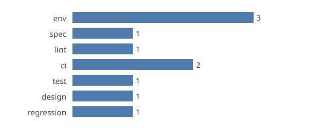

# Informe de desarrollo (generado)

> Generado por `node scripts/devlog-report.mjs` a partir de `devlog/`. No editar a mano.

## Totales

| Métrica | Valor |
|---|---|
| Sesiones | 1 |
| Tiempo | 1.5 h (90 min) |
| Tokens | entrada 254, salida 114611, caché creación 497725, caché lectura 19683909 |
| Costo equivalente API | US$ 9.37 |
| Errores y retrabajos | 10 (tiempo medio de corrección 3.1 min, reincidencias 0) |
| Validaciones locales | 4 (2 en verde; la primera en verde: no) |
| Última validación | success, 36 tests, 6.8 min |
| Fases cerradas | 1 |

## Errores por categoría

| Categoría | Errores |
|---|---|
| env | 3 |
| spec | 1 |
| lint | 1 |
| ci | 2 |
| test | 1 |
| design | 1 |
| regression | 1 |

## Errores por quién los detectó

| Detectado por | Errores |
|---|---|
| linter | 2 |
| manual-run | 3 |
| review | 3 |
| ci | 2 |

## Detalle de errores

| ID | Categoría | Síntoma | Causa | Arreglo | Min |
|---|---|---|---|---|---|
| E001 | env | npm run lint in object-oriented reported 727 problems, almost all 'Delete ␍' from Prettier | clone checked out with core.autocrlf=true on Windows, so files had CRLF while the project enforces LF | repo-local core.autocrlf=false and re-checkout of both forks | 3 |
| E002 | env | pnpm -v crashed: corepack could not find pnpm.cjs | broken corepack cache on this laptop | not needed: the projects use npm lockfiles; used npm 10.9 | 0 |
| E003 | spec | the planned fix for object-oriented tests overlapped an existing open upstream PR (#1, Feb 2026) | diagnosis started from failing tests before reading the upstream PR list | dropped that improvement and chose use-case tests and root CI instead; documented in docs/diagnostico.md | 2 |
| E004 | lint | 3 prettier errors per project in the new createCourse.spec.ts (long template literals) | generated test lines over the print width | eslint --fix on tests/ | 1 |
| E005 | ci | validate.sh reported every target as failed: 'No such file or directory' for the log files | log path was relative to the repo root but the commands ran after cd into each worktree | absolute log path ($ROOT/$EVID) | 2 |
| E006 | ci | Jest found 0 tests inside the validation worktrees | worktrees lived under .validate/ and Jest's testMatch globs skip dot-directories | worktrees moved to validate-wt/ (ignored through .git/info/exclude) | 6 |
| E007 | env | git worktree remove failed with 'Filename too long' (node_modules) | Windows MAX_PATH without core.longpaths | core.longpaths=true for the removal and automatic cleanup at the end of validate.sh | 2 |
| E010 | test | code review simulated 2M faker sentences: 'saves a valid course' could fail about 1 in 4,650 runs | CourseMother uses faker.lorem.sentence(), which can exceed the 100-char title limit; 5 repeated runs could not reveal it | fixed valid title in the tests that depend on it; PR text no longer claims flakiness was ruled out | 5 |
| E011 | design | the CI PR would arrive with a red object-oriented job, lowering the chance of acceptance | matrix included an example that is broken on upstream main pending someone else's PR | object-oriented left out of the matrix with a comment; also permissions: contents: read and actions v5 | 4 |
| E014 | regression | the fork README section disappeared from main and showed up in the ci/root-workflow PR branch | 'git commit -am' on the PR branch also committed the README edit carried over from main's working tree (999ea05) | new commit on the branch restoring README.md to upstream (force-push was not allowed); net PR diff is only ci.yml; README section restored on main | 6 |

## Validaciones locales

| Fecha | Rama | Resultado | Tests | Min | Paso fallido |
|---|---|---|---|---|---|
| 2026-11-20T22:35:06-05:00 | main | failure | 0 | 0.2 | ci/root-workflow:functional-currying |
| 2026-11-20T22:40:38-05:00 | main | failure | 0 | 5.2 | ci/root-workflow:functional-currying |
| 2026-11-20T22:48:25-05:00 | main | success | 36 | 5.8 |  |
| 2026-11-20T23:21:17-05:00 | main | success | 36 | 6.8 |  |

## Qué funcionó y qué mejoraríamos en el proceso

- **Leer los PR abiertos del original antes de elegir mejoras.** En el repo de ejemplos, el arreglo más obvio ya estaba propuesto por otra persona; detectarlo pronto evitó un PR duplicado (E003).
- **Diagnosticar con códigos de salida, no con `grep` de la salida.** Un fallo de configuración de ESLint pasó como "ok" en el primer diagnóstico (E008).
- **Validar cada rama en un worktree limpio** (`npm ci` desde el lockfile) reprodujo lo que vería la CI de Codely y sacó a la luz dos problemas que el clon de trabajo ocultaba (E008, E009).
- **Las revisiones independientes valieron la pena:** encontraron un test inestable 1 de cada ~4.650 veces que 5 repeticiones no podían ver (E010), un PR que llegaría en rojo (E011) y una afirmación falsa sobre la licencia (E012).
- **Windows:** fijar `core.autocrlf=false` y `core.longpaths=true` en cuanto se clona un proyecto con Prettier y `node_modules` grandes (E001, E007).
- **Mejoraríamos:** probar el script de validación con un solo objetivo antes de lanzarlo entero (E005, E006).
- **Ramas de PR solo con `git add <rutas>`:** un `commit -a` arrastró al PR de CI un cambio del README del `main` del fork (E014). Lo arreglamos con un commit nuevo, porque no se permite force-push. La próxima vez: un worktree por rama.

